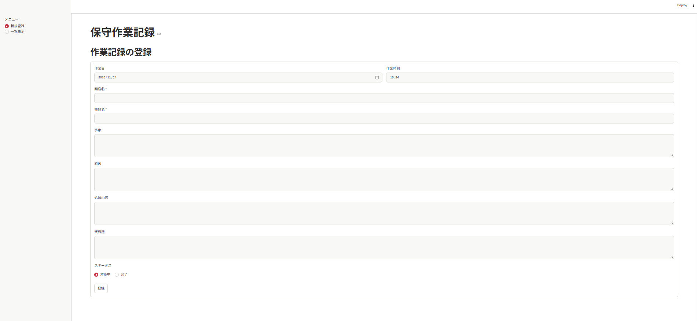
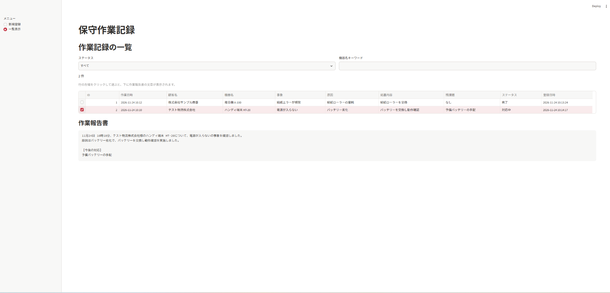

# 保守作業記録アプリ

カスタマーエンジニアの保守作業を記録し、顧客向けの作業報告書の文章を自動で作成するWebアプリです。

## 作った背景

通信インフラの監視・運用業務に携わる中で、障害対応そのものよりも、記録や報告に時間がかかると感じていました。
そこで、作業内容を決まった項目で記録するだけで報告書の文章ができあがる仕組みを作り、現場の報告業務を効率化することを目指しました。

## デモ

公開URL:準備中

## 主な機能

- **作業記録の登録**:作業日時、顧客名、機器名、事象、原因、処置内容、残課題、ステータス(対応中/完了)を記録
- **一覧表示と絞り込み**:ステータスと機器名のキーワードで絞り込み
- **作業報告書の文章を自動作成**:一覧から1件選ぶと顧客向けの文章を表示。コピーボタンでそのまま貼り付けられる

## 画面イメージ

### 作業記録の登録



### 作業報告書の作成



## 使用技術

| 区分 | 技術 |
|---|---|
| 言語 | Python |
| フレームワーク | Streamlit |
| データベース | SQLite |
| 開発支援 | Claude Code(生成AI) |

## 工夫した点

- **画面とDB処理のファイル分割**:画面は `app.py`、データベース処理は `db.py` に分け、どこに何が書いてあるかを追いやすくしました。
- **自然な報告書の文章**:原因や処置内容が未入力でも「原因はで、」のような不自然な文にならないよう、空の項目は文から省く処理にしました。
- **機密情報の除外**:顧客情報を含むデータベースファイルと `.env` を `.gitignore` で除外し、GitHubに上がらないようにしました。

## 今後の改善案

- 生成AIで報告書の文章を整える
- 記録の編集・削除
- 報告書の文章のテンプレート選択(顧客向け/社内向けなど)
- CSV出力

## ローカルでの起動方法

```bash
# 0. アプリのフォルダへ移動
cd maintenance-log-app

# 1. 仮想環境を作成して有効化(Windowsの例)
python -m venv venv
venv\Scripts\activate

# 2. 必要なライブラリをインストール
pip install -r requirements.txt

# 3. アプリを起動(ブラウザが自動で開きます)
streamlit run app.py
```

初回起動時に、データベースファイル `maintenance.db` が自動で作成されます。
